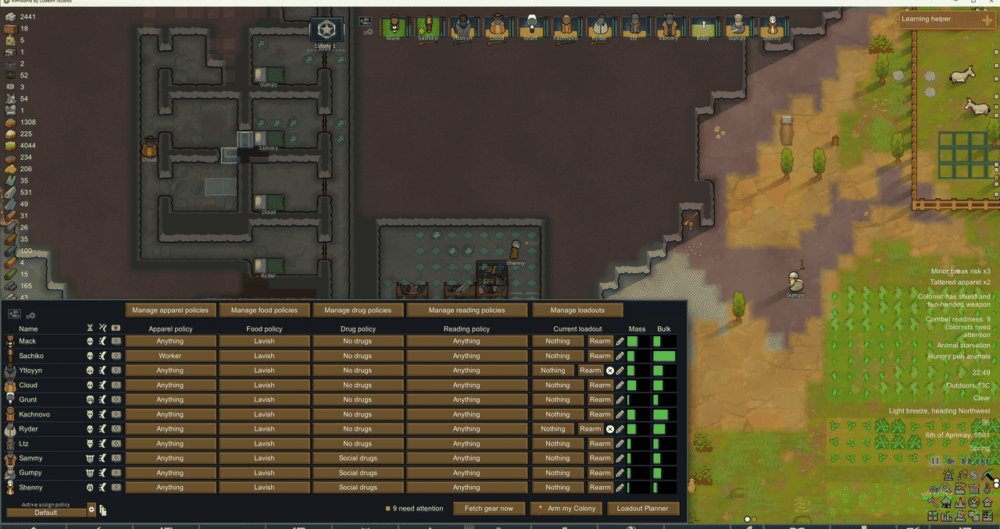

# CE Reloaded

A loadout, ammo and equipment automation add-on for [Combat Extended](https://github.com/CombatExtended-Continued/CombatExtended) (RimWorld 1.6). It does CE's bookkeeping for you - as much or as little of it as you want.



## What it does

- **Arm my Colony** - one button in the Assign tab: picks a weapon per colonist by skill, builds Equipment Packs, queues the ammo and offers to craft what is missing, then shows a report of what happened.
- **Loadout Planner** - the same steps one at a time: Equipment Packs, Roles (optional), Equip Colonists (pick a weapon per colonist from a list with scores, stock and cost) and a Bill Overview that keeps ammo production sized to demand.
- **Fetch gear now** - everyone collects their loadout immediately instead of one item every 30 seconds.
- Sidearms, grenades and shields, Supply Loadouts (assigned / stored / in production / missing), mass-replace ammo, a combat-readiness indicator, a gear-tab loadout panel and 13 languages.

Everything the mod creates is an ordinary CE loadout or bill you can still edit in CE's own editor. It adds no items, ammo or defs and leaves CE's balance untouched. It is safe to add to an existing save, and Mod Settings has a button that prepares a save for removing the mod.

## Requirements

- RimWorld 1.6
- [Harmony](https://steamcommunity.com/sharedfiles/filedetails/?id=2009463077)
- [Combat Extended](https://steamcommunity.com/sharedfiles/filedetails/?id=2890901044) - load CE Reloaded **after** it

## Installation

Subscribe on the Steam Workshop, or copy this folder into `RimWorld/Mods/` and build the assembly (see below).

## Building from source

You need the .NET SDK and local copies of RimWorld, Harmony and Combat Extended. The project references them through two properties with Steam defaults; override them for your install:

```
dotnet build Source/CEReloaded.csproj -p:RimWorldDir="C:\Path\To\RimWorld" -p:WorkshopDir="C:\Path\To\steamapps\workshop\content\294100"
```

The assembly is written to `1.6/Assemblies/CEReloaded.dll`.

## Contributing

Bug reports and pull requests are welcome. The mod is maintained in spare time, so answers may take a while.

## License

[CC BY-NC-SA 4.0](LICENSE), the same license as Combat Extended. CE Reloaded is an independent add-on and not affiliated with the Combat Extended team.

## Support

If CE Reloaded saves you some micromanagement: [ko-fi.com/butch182](https://ko-fi.com/butch182) - entirely optional.
